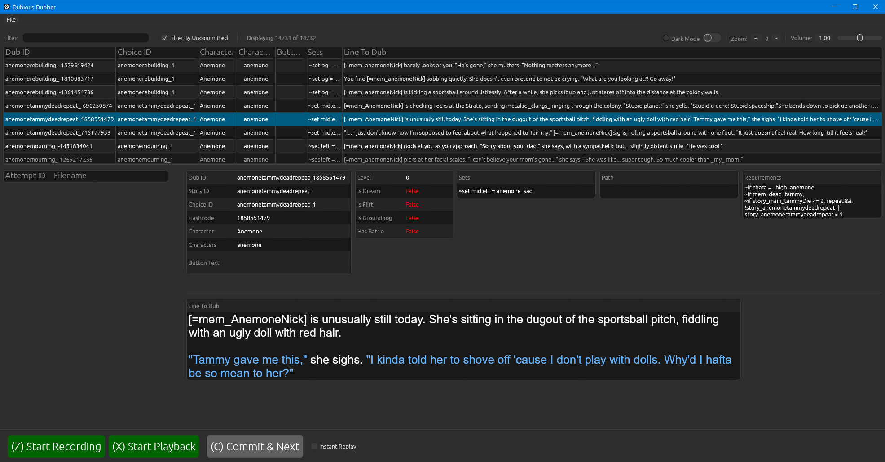
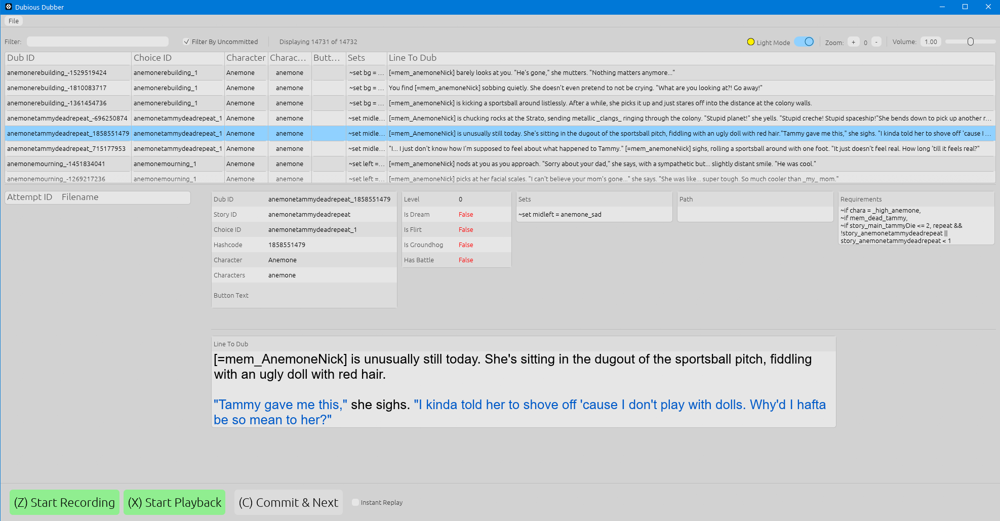
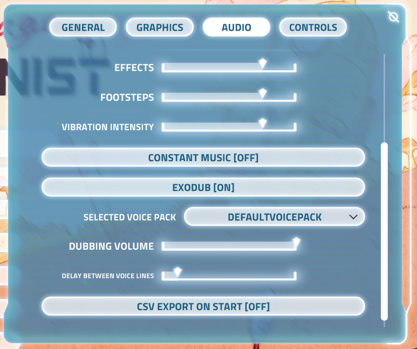
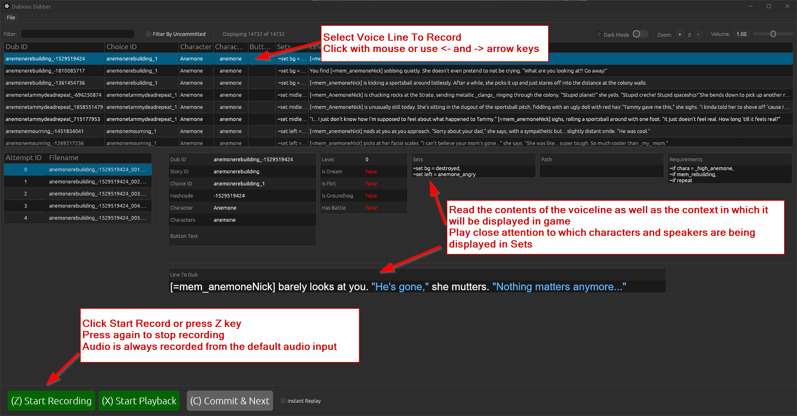
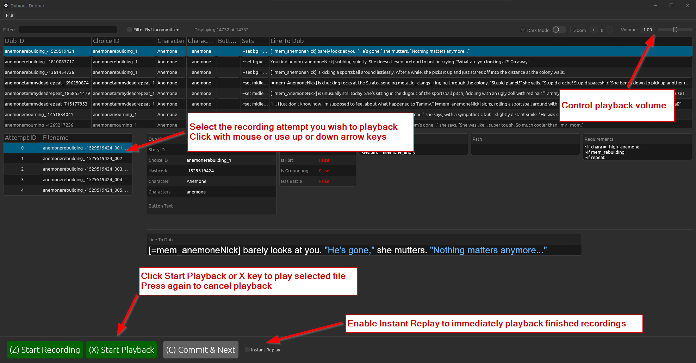
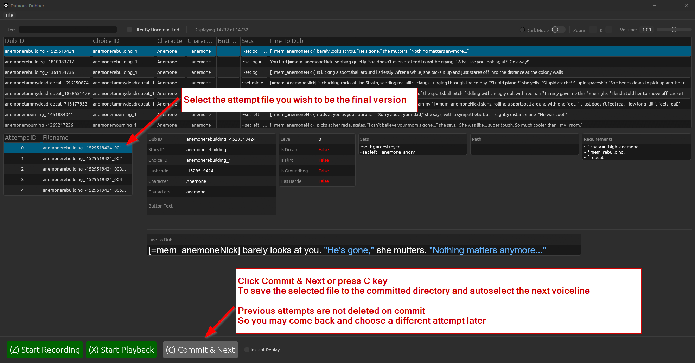

# DubiousDubber


[License: GPL v3](https://www.gnu.org/licenses/gpl-3.0) 

A fast, custom tool for creating [ExoDubber](https://github.com/%5Byour-username%5D/ExoDubber) voicepacks to dub the game [*I Was a Teenage Exocolonist*](https://store.steampowered.com/app/1148760/I_Was_a_Teenage_Exocolonist/).

DubiousDubber takes care of tracking game voicelines, managing multiple takes and saving final audiofiles with the correct [ExoDubber](https://github.com/%5Byour-username%5D/ExoDubber) filename.

I Was a Teenage Exocolonist* has a rough wordcount of 580,000. For comparison, entire Lord of the Rings Trilogy is roughly 550,000 words. So you **will** want assistance in creating a custom voicepack.

> **Disclaimer:** DubiousDubber is an unofficial, fan-made tool. It is not affiliated with or endorsed by Northway Games. [*I Was a Teenage Exocolonist*](https://store.steampowered.com/app/1148760/I_Was_a_Teenage_Exocolonist/) and its assets belong to their respective owners.

---

## Features

- Easy viewing of all game voicelines and related context details
- Tracks unlimited takes for each voice line
- Keyboard controls to record, review and commit voicelines without touching the mouse
- Voiceline text highlighting
- Allow filtering out of already completed voice lines
- Custom filtering of lines by id
- Light and Dark mode themes
- Optional instant playback of last recording
- Configurable UI scale for easy reading
- Written in rust to ensure UI feels fast and snappy


## Screenshots




## Installation

### Prebuilt binaries

1. Go to the Releases page.
2. Download the build for your platform (Only Windows binaries are currently avaialble).
3. Extract it anywhere.
4. Place the `AllLinesExport.csv` CSV file from [ExoDubber](https://github.com/%5Byour-username%5D/ExoDubber) into the same directory
5. Launch `DubiousDubber.exe`

### Via Cargo

```bash
cargo install --git https://github.com/[your-username]/DubiousDubber
```

Verify the install:

```bash
dubiousdubber --version
```

---

## Quick Start Tutorial

How to create a custom voicepack for ExoDub from scratch

### 1. Load ExoDubber Export CSV

- Install [ExoDubber](https://github.com/%5Byour-username%5D/ExoDubber) into your copy of [*I Was a Teenage Exocolonist*](https://store.steampowered.com/app/1148760/I_Was_a_Teenage_Exocolonist/).

- Go to Settings > Audio in-game and scroll to the bottom

- 

- Set "CSV EXPORT ON START" to be **ON**

- Close and restart Exocolonist back to the main menu

- Check your Exocolonist's game folder for the newly generated `AllLinesExport.csv` file

- Copy/Paste `AllLinesExport.csv` into your DubiousDubber.exe directory OR Select it from DubiousDubber with File > Load CSV

### 2. Record Takes

- 

- Select the line you want to record from the table at the top of the screen. You can also use the left and right arrow keys or the Page Up and Page Down buttons

- Read the contents of the voiceline as well as the context in which it will be displayed in game
  Play close attention to which characters and speakers are being displayed in Sets

- Click Start Record or press Z key
  Press again to stop recording
  Audio is always recorded from the default audio input

### 3. Playback Takes

- 

- Select the recording attempt you wish to playback from the table in the bottom left of the screen. Click with mouse or use up or down arrow keys.

- Click Start Playback or X key to play selected file
  Press again to cancel playback

- Enable Instant Replay checkbox to immediately playback finished recordings

- Volume controls are found in the top right of the screen

### 4. Commit Takes

- 

- Select the attempt file you wish to be the final version from the table in the bottom left of the screen. Click with mouse or use up or down arrow keys.

- Click Commit & Next or press C key, to save the selected file to the committed directory and autoselect the next voiceline 

- Previous attempts are not deleted on commit, so you may come back and choose a different attempt later. You can find them in the `Attempts` directory.

### 5. Repeat

Repeat steps 1-3 untill all lines you wish to record have been comitted to the `Commit` directory next to DubiousDubber.exe

### 6. PostProcessing

DubiousDubber records all audio in raw .wav format. 

It is important to perform even basic post processing on the audio files to make it sound nicer.  

It is recommended to lookup online tutorial of how to post-process audio for audiobooks or podcasts to learn how to:

- Reduce background noise

- Normalise volume

- Filter out mouth sounds

- Equailise the audio to make it easier to listen to

You will likely need to create a script to run the same processing over the audio files in bulk.

### 7. File Compression

WAV files are uncompressed and therfore very large.
Thus you will need to use [FFMPEG](https://ffmpeg.org/) or a tool based on FFMPEG like [HandBrake](https://handbrake.fr/) to compress the audio files into the recommended OGG file format.

E.g. Converting wav to ogg using ffmpeg at a quality of 6 out of 10

`ffmpeg -i input.wav -c:a libvorbis -q:a 6 output.ogg`

## 8. Save Voicepack

Now place your processed .ogg audio files inside

`Exocolonist\BepInEx\plugins\ExoDub\VoicePackLibrary{VoicePackName}`

---

## Contributing

Feel free to send pull requests to improve on this open source project. By contributing, you agree that your contributions will be licensed under the GPLv3.

**Note: Please limit the use of AI for any code contributions.**

You can also help by helping create new properly voice acted voicepacks for Exodub to use and for people to enjoy. There is a custom made tool to help drastically simplify and speed up the process of creating a custom voicepack. So head on over to the [DubiousDubber](https://github.com/7h0m4s/DubiousDubber) repository *(named after contributer DubiousPhysics)* for a full tutorial on voicepack creation.

**Note: Please do not create voicepacks using AI Text-To-Speech voice generators. A lot of people put a lot of time and love into this game, so the least we can do is respect that level of effort.**

## Credits

- Northway Games, creators of *The Exocolonist*
- DubiousPhysics, coding and testing support

## License

Exodub is free software: you can redistribute it and/or modify it under the terms of the **GNU General Public License, version 3**, as published by the Free Software Foundation.